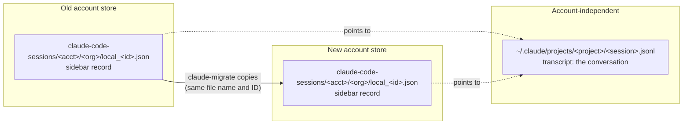

<p align="center">
  
</p>

# claude-migrate

> **Unofficial community tool. Not affiliated with or endorsed by Anthropic.**

[](https://github.com/onlyilkr/claude-migrate/actions/workflows/ci.yml)
[](https://github.com/onlyilkr/claude-migrate/releases)
[](go.mod)
[](https://goreportcard.com/report/github.com/onlyilkr/claude-migrate)
[](LICENSE)
[](#limitations)

Move your Claude Desktop **Code** sessions to another account on the same Mac, so the sidebar shows them again.

When you switch Claude accounts (personal to Team, for example), the Code tab in Claude Desktop starts empty. Nothing was deleted: Desktop keeps one sidebar store per account and organization, and it only reads the store of the account you are signed in to. `claude-migrate` copies the session records from the old account's store to the new one, keeps their IDs (so pins carry over), clears the links that belong to the old account, and never touches transcripts or existing files.

## How it works

A Desktop Code session has two halves. Only one of them is tied to an account.



- The **transcript** is shared by all accounts. `claude --resume` sees it regardless of who is signed in.
- The **sidebar record** lives in an `<account>/<org>` folder. This is what "disappears" after a switch.
- `claude-migrate` copies records only. Transcripts are never read for content, moved or modified.

## Features

- Copies sidebar records between account/organization stores, keeping the JSON value of every field it does not need to change, unknown fields included.
- Keeps the session ID, so pins carry over: Desktop keeps one global pin list keyed by session ID, shared by all accounts.
- Dry run by default. `apply` is additive only and never overwrites a file.
- Every write is logged to a manifest before it happens; `undo` removes exactly what a run created, and only if the files are unchanged.
- Refuses to write while Claude Desktop is running, and cross-checks the target account against the one Desktop last used.
- Skips sessions whose transcript is gone (they would open empty); `--include-orphans` copies them anyway.
- Never brings back a session you deleted in the target account: Desktop leaves a `deleted_<id>` marker, and with kept IDs that marker names the same session.
- Fails closed on a folder layout it does not recognize.
- Machine-readable `--json` output on every command except `version`. Standard library only, no network access.

## Install

Homebrew cask:

```sh
brew install --cask onlyilkr/tap/claude-migrate
```

The binary is not signed or notarized, so the cask removes the macOS quarantine flag from it on install; without that, Gatekeeper would refuse to run it. If you would rather not have a cask do that, use `go install` (builds on your Mac, no workaround needed):

```sh
go install github.com/onlyilkr/claude-migrate/cmd/claude-migrate@latest
```

Or download a release binary (`darwin/arm64` or `darwin/amd64`) from the [releases page](https://github.com/onlyilkr/claude-migrate/releases) and verify it against the published checksums:

```sh
shasum -a 256 -c checksums.txt   # run next to the archive; the other architecture's archive is reported as missing
```

## Quick start

1. Sign in to the **new** account in Claude Desktop once, so its store exists. Then quit Desktop completely with **Cmd+Q**.
2. Open **Terminal** and run the tool there. Do not run it from Desktop's own Code tab: quitting Desktop would end that session, and the tool refuses to write while Desktop runs.
3. Preview. Nothing is written:
   ```sh
   claude-migrate            # same as: claude-migrate plan
   ```
   With several candidate stores, run `claude-migrate doctor` to list them.
4. Apply, using the command the plan printed:
   ```sh
   claude-migrate apply --from 1a2b3c4d/5e6f7a8b
   ```
5. Open Claude Desktop. The sessions appear in the new account's sidebar, and pinned sessions are still pinned.

Changed your mind? `claude-migrate undo` removes exactly the files the last run created.

## Commands

| Command | What it does | Writes? |
|---|---|---|
| `claude-migrate` / `plan` | Shows what would be copied and what needs manual follow-up. Picks the source for you when there is only one candidate; asks on a TTY otherwise. | No |
| `apply --from X` | Copies the records and writes a manifest to `~/.claude-migrate/runs/`. `--from` is required. | Yes |
| `undo [manifest]` | Removes the files a run created (latest run by default), skipping any you changed since. Without a path it refuses, instead of picking an older run, when a newer run file is unreadable. | Yes (deletes) |
| `pins` | Lists pinned source sessions: `pinned in target`, `copied under a different ID; pin it again in Desktop` or `not migrated yet`. | No |
| `doctor` | Desktop state, signed-in account, whether Desktop last used the same account, stores, `cleanupPeriodDays`. | No |
| `version` | Prints the version. | No |

| Flag | Applies to | Meaning |
|---|---|---|
| `--from <acct>/<org>` | `plan`, `apply`, `pins` | Source store. Unique prefixes work (`1a2b3c4d/5e6f7a8b`). |
| `--to <acct>/<org>` | `plan`, `apply`, `pins` | Target store. Defaults to the account Claude Code is signed in to (`~/.claude.json`). Passing it skips the Desktop account cross-check. |
| `--include-orphans` | `plan`, `apply` | Also copy sessions whose transcript is missing. They open empty in Desktop. |
| `--force` | `undo` | Also remove files that changed since the run. Bypasses no other protection. |
| `--json` | all but `version` | Machine-readable output. |

### Exit codes

| Code | Meaning |
|---|---|
| 0 | OK |
| 1 | Error (I/O failure, incomplete undo) |
| 2 | Usage error: bad flag, unresolvable or ambiguous store, source equals target, no signed-in account, a `~/.claude.json` that cannot be read or parsed, `undo` of a manifest path that does not exist, `undo` without a path when there are no runs or a newer run file is unreadable, or `apply` with an account mismatch (see below) |
| 3 | Claude Desktop is running, or cannot be checked (SSH session) |
| 4 | Unrecognized Desktop folder layout, or the target store does not exist |

## What changes in a copied record

| Field | Result |
|---|---|
| `bridgeSessionIds` | Emptied. These are the old account's cloud session IDs. |
| `scheduledTaskId` | Removed. It points at a task of the old account. |
| `sessionId` and file name | **Kept.** The copy has the same `local_<id>.json` name as the source. |
| Everything else | Value-preserved: each field's original JSON is kept verbatim (keys are re-sorted and re-indented), including fields this tool does not know about. |

Unknown fields never block a run; `plan` lists them for information.

## Safety model

- **Dry run by default.** Only `apply` and `undo` write.
- **Additive only.** A copy is written to a unique temp file and published with `link(2)`, which fails atomically if the name exists, so it never overwrites, even under a race. If a write fails after its manifest entry, the entry is retracted so `undo` cannot treat whatever sits at that path as ours. If the target already holds a file of that name that belongs to a different session, or an entry of that name that is not a regular file (a symlink or folder), the record is skipped and reported (`name_conflicts`).
- **Manifest before write.** Each file is recorded (with its SHA-256) and fsynced to the run log before it is written, so a crash cannot leave an unrecorded file.
- **Hash-checked undo.** `undo` only deletes files named in the manifest, inside the target store, whose hash still matches. A hand-edited manifest cannot point it elsewhere. A file that a newer run recorded again (same path, same kept ID) belongs to that run: undoing the older run keeps it and reports it as `superseded` ("kept for a newer run"). Newer runs that cannot be read are listed, because they protect nothing.
- **Desktop guard.** `apply` and `undo` refuse while Desktop runs. The check asks Launch Services about the current GUI login session, so run the tool in a Terminal on the Mac itself; over SSH it cannot see Desktop and refuses (exit 3). With `--home`, the guard still applies whenever the target is, by file identity, a store under your real home (symlinks, `.`, case variants included).
- **Account cross-check.** Claude Desktop records the account it last used in `config.json`. If you do not pass `--to` and that account differs from the one in `~/.claude.json`, `apply` stops (exit 2) and `plan`/`pins` print a warning on stderr. Pass `--to <account>/<org>` to choose explicitly.
- **Fail closed.** An unfamiliar folder layout, a missing target store, or a malformed account ID stops the run instead of guessing. The tool never creates the target store.

## Limitations

- macOS only.
- Local Desktop **Code** sessions only. Cloud sessions, Cowork sessions, and claude.ai chats, Projects, artifacts and memory live on Anthropic's servers or in other stores and are out of scope.
- Scheduled tasks are reported, not moved: recreate them in the target account.
- Sessions whose cwd is inside the old account's scratch folder keep working only while that folder exists; do not delete it.
- Transcripts older than `cleanupPeriodDays` (default 30 days) are deleted by Claude Code. `plan` warns when the setting is absent.
- It relies on undocumented Desktop files, so a Desktop update can break it. Run `doctor` after an update, and expect fail-closed behavior rather than silent damage.

## Troubleshooting

**A session I deleted in the new account was not copied again.** By design: the target's `deleted_<id>` marker is respected and the plan lists it as "deleted in target". A session that an older tool copied under a different ID and that you then deleted cannot be matched this way, because its marker names the other ID.

**The account cross-check did not catch a wrong organization.** Desktop's `config.json` records only the last account (`lastKnownAccountUuid`), not the organization. If one account has several organizations, check the `Target:` line of `plan` or pass `--to <account>/<org>`.

**Can I delete the sessions from the old account afterwards?** Wait until you have opened a few migrated sessions in the new account. Both copies share the same session ID and transcript, and how Desktop treats shared state when one copy is deleted is not documented.

**The sidebar is still empty after `apply`.** Desktop writes its in-memory list back on exit. Quit it fully with Cmd+Q (not just the window), relaunch, and make sure you are signed in to the target account.

**`~/.claude.json is signed in to account … but Claude Desktop last used account …`.** The two disagree about which account is current. Check `claude-migrate doctor`, then pass `--to <account>/<org>` for the store you actually want.

**"no transcript (skipped)" is not zero.** Those records point at a transcript that is no longer in `~/.claude/projects` (often removed by `cleanupPeriodDays`). In Desktop they open empty. Copy them anyway with `--include-orphans`, or leave them behind.

**How do pins work?** Desktop stores pins as a single list of `local_<id>` values in `claude_desktop_config.json`, shared by all accounts. Because the copy keeps its ID, it is pinned as soon as it appears. The tool reads that list (read-only) to decide which source sessions are pinned; a record's own `isStarred` flag is only the fallback when the list cannot be read. `claude-migrate pins` shows each pinned source session as `pinned in target` or `not migrated yet`. A session copied by an older tool under a new ID counts as `pinned in target` if you already pinned that copy again, and as `copied under a different ID; pin it again in Desktop` otherwise; `plan` counts only the latter in its pin follow-up line.

**A record was skipped as a name conflict.** The target already has a file with that name for a different session. It is left untouched and listed in the plan.

## Try it on a copy

To see what a run does without touching your real Desktop data, build a scratch directory laid out like a home and point `--home` at it:

```sh
SCRATCH=$(mktemp -d)
mkdir -p "$SCRATCH/Library/Application Support/Claude"
cp -R ~/Library/Application\ Support/Claude/claude-code-sessions "$SCRATCH/Library/Application Support/Claude/"
cp ~/Library/Application\ Support/Claude/config.json "$SCRATCH/Library/Application Support/Claude/"  # enables the account cross-check
# Copy only the pin list (jq ships with macOS 15+): the full claude_desktop_config.json can hold MCP server secrets.
jq '{preferences:{epitaxyPrefs:{"starred-local-code-sessions":.preferences.epitaxyPrefs["starred-local-code-sessions"]}}}' \
  ~/Library/Application\ Support/Claude/claude_desktop_config.json > "$SCRATCH/Library/Application Support/Claude/claude_desktop_config.json"
cp ~/.claude.json "$SCRATCH/"
claude-migrate plan --home "$SCRATCH" --include-orphans
claude-migrate apply --home "$SCRATCH" --from <old-account>/<old-org> --include-orphans
claude-migrate undo --home "$SCRATCH"
```

The Desktop check is skipped for a home that is not yours, and nothing outside the scratch directory is touched. `~/.claude/projects` need not be copied; `--include-orphans` stands in for the transcripts you left out. Delete the scratch directory when done: the copy of `~/.claude.json` holds your account details. `--home` is an undocumented testing flag.

## Alternatives

Other community projects that touch the same problem space (none is affiliated with this one). Descriptions summarize each project's own README as of October 2026:

| Tool | What it does |
|---|---|
| [claude-code-export-import](https://github.com/Dangelo123/claude-code-export-import) | Exports and imports Claude Code sessions between machines, accounts and app builds; rewrites transcripts. |
| [transfer-claude-sessions](https://github.com/mofchris/transfer-claude-sessions) | Copies Desktop sessions to a new account with dry run, backup and undo; Windows PowerShell. |
| [claude-session-migrate](https://github.com/DarkKandaoMaster/claude-session-migrate) | Claude Code skill and script that copies Desktop sidebar records to the new account; Windows-focused, backs up the sessions folder first. |
| [claude-account-migration](https://github.com/Gekko-z/claude-account-migration) | Write-up of where Desktop keeps sessions and why a switch hides them, with helper scripts; macOS and Windows. |
| [cowork-migrate](https://github.com/vega-llc/cowork-migrate) | Moves Cowork sessions between Macs. |
| [claude-folder-move](https://github.com/claudio-medeiros/claude-folder-move) | Retargets Claude Code sessions when a project folder moves. |

## Development

```sh
make check      # test (race), vet, gofmt check, staticcheck
make build      # bin/claude-migrate
make snapshot   # local GoReleaser build, nothing published
```

See [CONTRIBUTING.md](CONTRIBUTING.md) for the TDD workflow and fixture rules. To add a regression fixture from your own store without leaking data, use `go run ./scripts/anonymize -src <store dir> -out <dir>` and check the output with the privacy grep described in [CONTRIBUTING.md](CONTRIBUTING.md#fixtures-and-personal-data).

## Contributing and security

Contributions are welcome; read [CONTRIBUTING.md](CONTRIBUTING.md) first. Report vulnerabilities privately as described in [SECURITY.md](SECURITY.md), not in a public issue. Release notes are in [CHANGELOG.md](CHANGELOG.md).

## License

[MIT](LICENSE)
